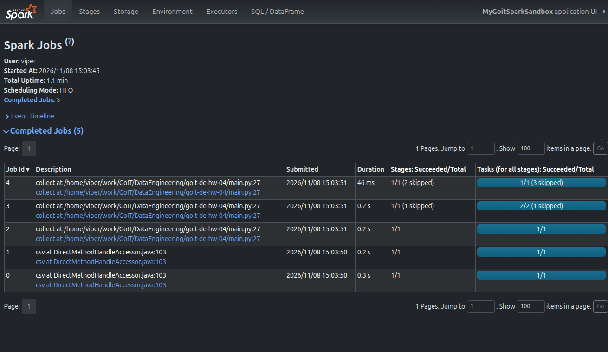
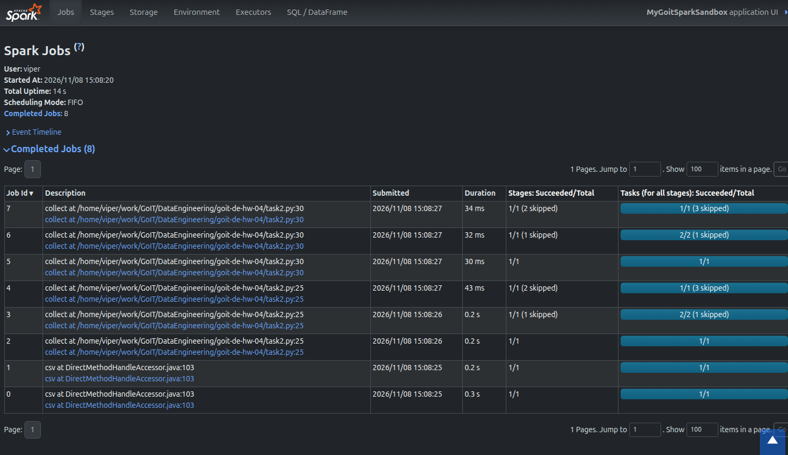
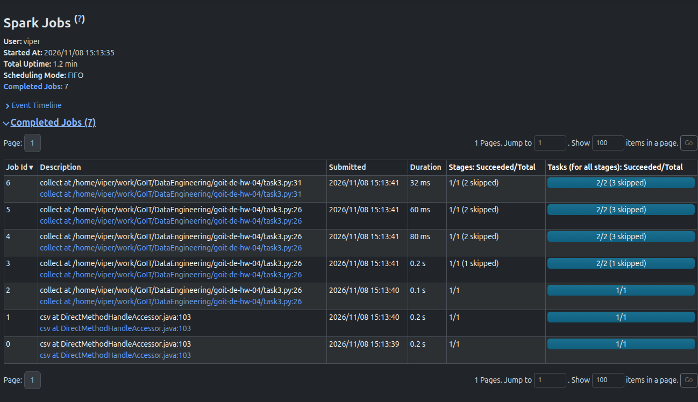

# goit-de-hw-04

## Чому проміжний `nuek_processed.collect()` додав одразу 3 Job?

- **Task 1** — 5 Job: 2 на читання CSV (`header` + `inferSchema`) і 3 на `collect()`.
- **Task 2** — 8 Job: 2 на читання CSV, 3 на проміжний `collect()` (рядок 25) і 3 на фінальний `collect()` (рядок 30).

Один `collect()` дає 3 Job, бо в плані є дві shuffle-операції: `repartition(2)` і `groupBy`.
Adaptive Query Execution (AQE, у Spark 3.x увімкнений за замовчуванням) запускає кожен shuffle-етап
як окремий Job, а потім іще один Job збирає результат:

1. Job — `repartition(2)` (читання + shuffle);
2. Job — `where` + `select` + часткова агрегація `groupBy` (shuffle);
3. Job — фінальна агрегація `count`, (`where count>2`) і `collect`.

Позначка **skipped** у 2-му і 3-му Job означає, що Spark бере shuffle-результати попередніх Job
цього ж action, а не рахує їх знову.

Spark працює ліниво і нічого не кешує, тому кожен action заново запускає весь ланцюжок трансформацій
від читання CSV. Другий `collect()` (уже з `where("count>2")`) має інший план, тож знову виконує
обидва shuffle і дає ще 3 Job.

**Task 1** ([task1.py](task1.py)):

**Task 2** ([task2.py](task2.py)):

## Чому з `cache()` Job стало менше?

- **Task 3** — 7 Job: 2 на читання CSV, 4 на перший `collect()` (рядок 26) і лише **1** на другий `collect()` (рядок 31).

`cache()` теж лінивий: він лише позначає DataFrame `nuek_processed_cached` для збереження в пам'яті.
Перший `collect()` виконує весь ланцюжок (обидва shuffle) і водночас записує результат `groupBy().count()`
у кеш. Тому тут 4 Job: з AQE на один більше, ніж без кешу, бо кешований план (`InMemoryRelation`) виконується як окремий підзапит.

Другий `collect()` (`where("count>2")`) уже не перераховує `repartition` і `groupBy`: він читає готові
дані з пам'яті й лише фільтрує їх. Shuffle немає, тому потрібен **1 Job**, а попередні стейджі
позначені як skipped.

Разом: 7 Job замість 8. Виграш тим більший, чим більше action виконується над тим самим
кешованим DataFrame. Після роботи кеш звільняємо через `unpersist()`.

**Task 3** ([task3.py](task3.py)):

